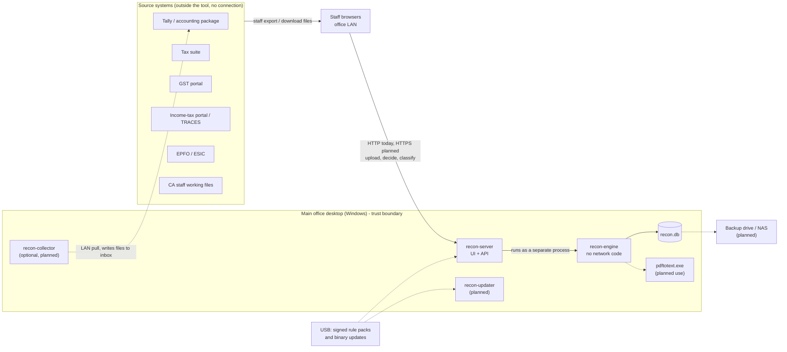

# System context

This page shows who and what Tool 1 talks to, how data gets in and out, and where the trust boundaries lie. It summarises the product spec v0.2 §1, §4.1, §5.1 and §8.1 ([recon-tool-spec.md](../../recon-tool-spec.md)), requirements v0.3 §2, §4 and §12 ([requirements-spec-tool1.md](../../requirements-spec-tool1.md)) and the technical spec §A3 and §B10 ([tool1-technical-spec.md](../../tool1-technical-spec.md)). For the inside of the system see [architecture-overview.md](architecture-overview.md).

## Context diagram



The same picture as text, for readers without a mermaid viewer:

```
 Tally   Tax suite   GST portal   TRACES   EPFO/ESIC   staff working files
   |         |           |           |          |              |
   +---------+-----------+-----------+----------+--------------+
                         | staff export / download files (manual file drop)
                         v
              Staff browsers on the office LAN
                         | HTTP (HTTPS planned)
 ========================|=========== MAIN OFFICE DESKTOP ===================
                         v
                    recon-server ----runs----> recon-engine (no network) --> recon.db
                         ^                           |
             USB packs --+                           +--> pdftotext.exe (planned)
             USB updates ----> recon-updater (planned)
             recon-collector (optional, planned) --LAN--> Tally, writes files to inbox
 ==========================================================================
                         | daily encrypted backup (planned)
                         v
                 second drive / external disk / NAS
```

## Actors

| Actor | Role in the system | Source |
|---|---|---|
| Partner | Season board; approves and activates rules; installs packs; exports; manages users | Requirements §3 |
| Manager | Runs reconciliations, decides findings, edits draft rules, exports | Requirements §3 |
| Staff | Uploads files, runs reconciliations, decides findings, classifies the Worklist | Requirements §3 |
| Read-only user | Views only | Requirements §3 |
| The firm's CA | Approves the rule book and law-table values; legally responsible for them | RU-10, RU-34 |
| Vendor / developer | Builds and signs content packs and binaries offline; never receives client data | Tech spec §B10 |

Today there are no logins: anyone who can reach the server can use it, and decisions carry a typed name (SPEC-006 part 3). Roles are planned (tech spec §B12).

## External systems and how their data arrives

No external system is connected. Every source reaches the tool as a file that staff export or download and then upload (project invariant 7; requirements §1.2).

| System | Documents | File types (requirements §4.1) | Read today |
|---|---|---|---|
| Tax suite (names **Open**, Q1) | Computation, tax audit report, Form 29B, Form 67, ITR JSON | JSON (primary), PDF fallback | Yes: generic and filing-pack JSON profiles (SPEC-003 to SPEC-006) |
| Tally / accounting package | Trial balance, ledgers, monthly summary, Day Book, registers | Tally XML (preferred), Excel; CSV | Monthly expense ledger CSV and register JSON only (SPEC-004, SPEC-006). Tally XML and Excel planned |
| GST portal | GSTR-1/1A, 3B, 2B, 9, IMS | JSON, Excel | GSTR-1 and GSTR-2B B2B invoices as JSON (SPEC-004 part 8) |
| Income-tax portal / TRACES | 26AS, AIS, Form 168, TDS files | Text, JSON, PDF | Form 26AS within the filing-pack JSON (SPEC-006) |
| EPFO / ESIC | ECR, contribution files | Text, Excel | Planned (fixed-width adapter, phase 5) |
| CA staff working files | Schedules, reconciliations, client sheets | Excel, Word tables, JSON | JSON only; Excel and Word planned |

Clients whose Tally books are kept at their own office send a backup or an export; the manual upload path covers this (gaps doc Part B.2). The optional `recon-collector` would pull from Tally over the LAN and write an ordinary file into the inbox (tech spec §A3; `cmd/recon-collector/README.md`, SPEC-043). It is not built.

## Trust boundaries

| Boundary | What crosses it | Controls today | Planned |
|---|---|---|---|
| Internet to office | Nothing. Tool 1 has no internet path (ENV-03) | The engine contains no connection code (archtest, [ADR-0001](decisions/ADR-0001-engine-network-proof.md)); no CDN or web fonts in the UI | — |
| USB to office | Signed content packs and binary updates (ENV-05) | None yet | Ed25519 verification against a public key in the binary, file hashes, fixtures run before install, rollback (tech spec §B10) |
| Office LAN to main desktop | Browser requests, uploaded files | Server binds to `127.0.0.1:8080` unless `--listen` says otherwise; upload limits (20 files, 64 MB each, 256 MB total); uploads in a temporary folder removed after the run | Logins, roles, sessions, HTTPS with a firm-local certificate (tech spec §B12.2; T-Q2 **Open**) |
| `recon-server` to `recon-engine` | Command-line flags, the PAN on standard input, JSON output | The engine runs as a separate process per request; it alone writes the database (SPEC-004 part 7) | One long-lived engine child, DB key and JSON-lines control messages on stdin/stdout (tech spec §A3.1) |
| `recon-engine` to `pdftotext.exe` | A local file path, layout text back | — (PDF adapter not built) | Only absolute vault paths, never a URL; a Poppler build without curl is worth doing before release ([ADR-0003](decisions/ADR-0003-bundle-poppler.md)) |
| Main desktop to backup media | Database and vault copies | — | Daily encrypted, signed backups with a tested restore (NF-07, tech spec §B12.2) |

See [data-and-threat-model.md](../security/data-and-threat-model.md) for the threats at each boundary.

## Outputs

- On screen: findings with both values, the difference and both sources; Cannot check items; the Worklist (built).
- Command line: text and `--json` reports from `recon-engine run`, `facts`, `result`, `rules`, `worklist` (built).
- Excel, watermarked PDF and a client query letter (planned, FD-08).

The tool never writes back to a source system. Corrections are made in the source software and the corrected file is uploaded again (§3.2).
